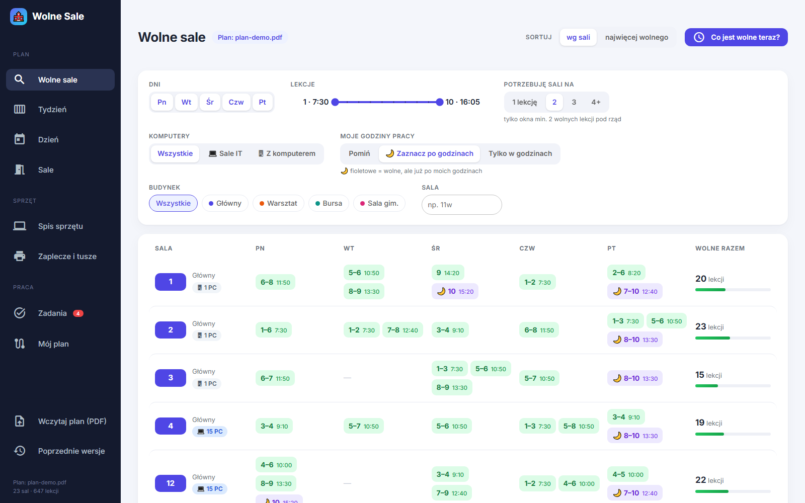
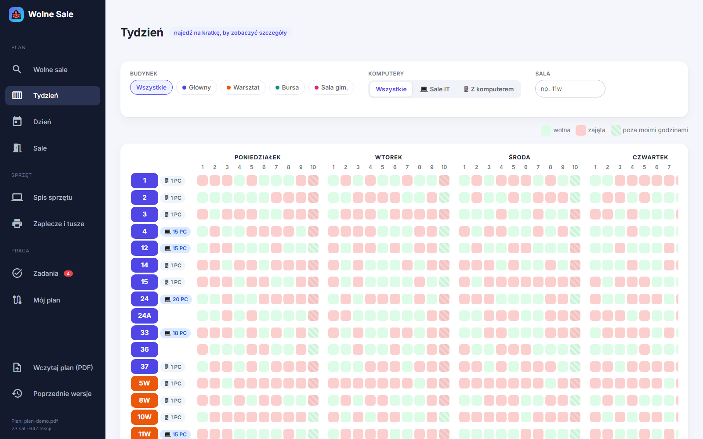
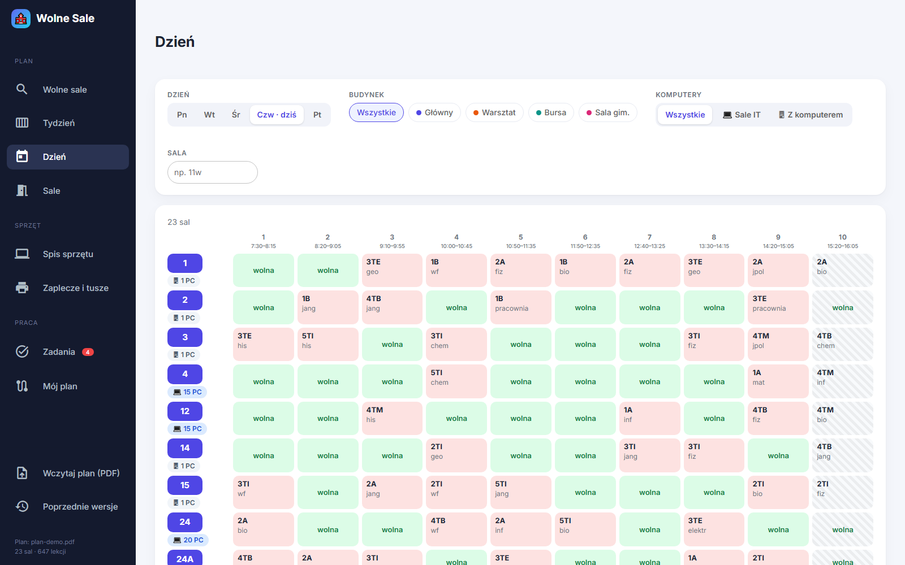
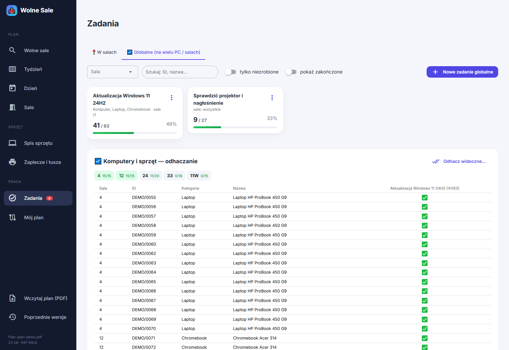
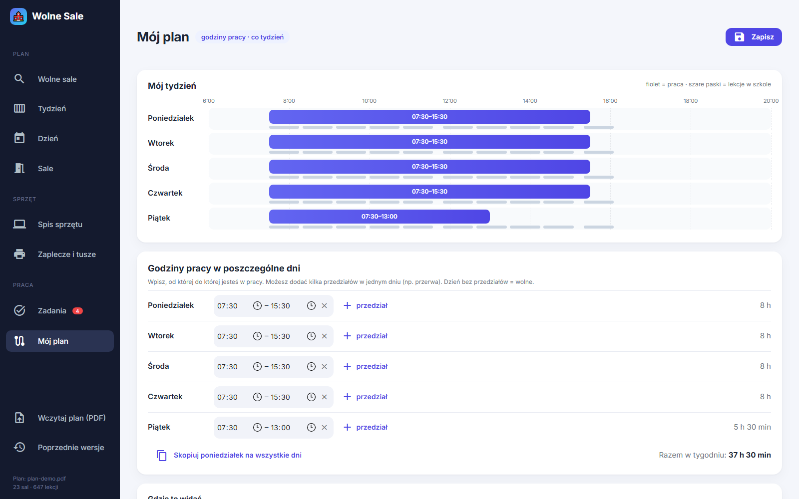

<div align="center">

# 🏫 School IT Hub

**A school IT technician's toolkit: find free classrooms from aSc Timetables, keep track of every computer
and device, manage printer supplies, and plan your work — all in one desktop app.**

Windows · macOS · Python · works offline · your data stays on your computer



🇵🇱 Polska wersja: [README.pl.md](README.pl.md)

</div>

> ℹ️ **All screenshots use fictional demo data** (`Nauczyciel 01…` = “Teacher 01”, devices `DEMO/…`).
> The user interface is in **Polish**. This is an independent tool, not affiliated with aSc Timetables.

---

## Why

In a school, the IT person needs a free room for longer work (installing software, servicing a lab),
needs to know **which computers and devices are where**, which printer takes which toner and when it will
run out, and what still has to be done in which room. The data lives in an aSc timetable and in the
accountant's inventory spreadsheets. This app brings it together.

## ✨ Features

### 🔎 Free rooms
When is each room free — **one row per room**, with free time windows merged per day (e.g. lessons `1–2` and `5–6`).
Filters: days, lesson range, “I need the room for N lessons in a row”, building, **computer labs only / rooms with a PC**.
A **“What's free right now?”** button. With your **working hours** set, it marks windows that are free but already
after your hours (🌙), or shows only what fits inside them.

### 🗓 Week & 📅 Day
| Week — all rooms at once | Day — who is where |
|---|---|
|  |  |

Hover a cell for details: lesson, time, subject, class, teacher. Lessons outside your working hours are hatched.

### 🚪 Room
The room's weekly timetable, its free windows, **equipment in the room** (how many PCs, laptops, projector…)
and **open tasks** for that room.


### 🖥 Equipment inventory (computers & devices)
Imports the school's **fixed-asset inventory spreadsheets (.xls)**. Free-text locations such as
`29/ w 12` (“listed in 29, actually in 12”), `12W użytkuje …` (“used by …”) or `15, 33, 2 w 16`
(several units under one inventory number) are parsed and split into individual devices.
Building → room tree, multi-category filters, **counts of PCs / laptops / Chromebooks per room**
(labs are detected automatically), **moving devices**, statuses (in service, lent), location certainty and a
**full change history**. Re-importing a newer spreadsheet updates the official data without overwriting your corrections.


### 🖨 Printer supplies
Toner and ink stock, **which cartridges each printer model needs** (black only / black + colour / CMYK) and which
are missing, **average consumption from replacement dates** with a “stock lasts until…” forecast, and a
**shopping list** you can copy.


### ✅ Tasks
Room tasks (due date, priority, status) and **bulk tasks** — e.g. “Windows update on every computer in the labs” —
with a **checkbox grid** and per-room progress.



### 🗺 My schedule
Your weekly working hours (clock time, recurring). Used by Free rooms, Day and Week.



---

## 🚀 Try it with demo data

After installing (below), run in the `aplikacja` folder:

```bash
python -m wolnesale --demo
```

(Windows with the venv: `.venv\Scripts\python -m wolnesale --demo` · macOS: `./start-mac.command --demo`)

This creates a `demo-dane/` folder with a fictional timetable, equipment, toners and tasks.

---

## ⚙️ Installation

You need **Python 3.12 or newer** — https://www.python.org/downloads/ . Installation is done **once** per computer
and downloads the libraries from the internet (a few minutes).

### 🪟 Windows
1. Install Python — tick **“Add python.exe to PATH”** in the installer.
2. Double-click **`instalacja-windows.bat`** (“installation”) and wait for “Gotowe” (“Done”).
3. Start the app by double-clicking **`start.bat`**.
   If the app window does not open, use **`start-przegladarka.bat`** — the same app in your web browser.

The app window uses **Microsoft Edge WebView2**, which is included in Windows 10/11.

### 🍎 macOS
1. Install Python from python.org (or `brew install python`).
2. Open **Terminal** in the project folder and run:
   ```bash
   ./instalacja-mac.command
   ```
   If macOS says “permission denied”, run this once first:
   ```bash
   chmod +x instalacja-mac.command start-mac.command
   ```
3. Start the app by double-clicking **`start-mac.command`** (the first time: right-click → **Open** if macOS
   warns about an unidentified developer).

The app window uses the system's built-in Safari engine — nothing else to install.

<details><summary>Manual installation (any OS)</summary>

In the `aplikacja` folder:
```bash
python -m venv .venv
```
Windows:
```bash
.venv\Scripts\python -m pip install -r requirements.txt
```
```bash
.venv\Scripts\python -m wolnesale
```
macOS / Linux:
```bash
.venv/bin/python -m pip install -r requirements.txt
```
```bash
.venv/bin/python -m wolnesale
```
</details>

### First steps
1. **Wczytaj plan (PDF)** (“Load timetable”) — in aSc Timetables print the **teachers' timetables** to PDF.
   (Exporting XML from aSc requires a licence; printing to PDF does not.) You get a report before anything is replaced.
2. **Spis sprzętu → Importuj ewidencję** (“Equipment → Import inventory”) — select the `.xls` inventory files
   (you can select all of them at once).
3. **Mój plan** (“My schedule”) — enter your working hours.

### Launch options
| Option | What it does |
|---|---|
| *(none)* | desktop app window |
| `--browser` | in your web browser (http://127.0.0.1:8765) |
| `--siec` | “network”: also reachable from your **phone** on the same Wi-Fi — `http://<computer-ip>:8765` |
| `--demo` | fictional demo data |
| `--dane FOLDER` | use data from another folder |

---

## 🔒 Data & privacy

Everything runs **locally** — nothing is sent anywhere. All data lives in the `dane/` folder, which is in
`.gitignore` and **never goes into the repository**:

| Folder | Contents |
|---|---|
| `dane/zrodla/` | copies of imported files (timetable PDF, inventory .xls) — never modified |
| `dane/program/plan.json` | the active timetable |
| `dane/program/zasoby.xlsx` | equipment, history, rooms, supplies, tasks, working hours — **you can open it in Excel** |
| `dane/kopie/` | automatic backups before every save |

You can copy the `dane/` folder between computers (Windows ↔ Mac). Don't copy `aplikacja/.venv` —
each computer creates its own.

---

## 🧱 Project structure

```
start.bat / start-mac.command        start the app
instalacja-windows.bat / -mac        one-time installation
aplikacja/
  wolnesale/core/                    logic (no UI): aSc PDF parser, inventory import, free windows,
                                     printer supplies & forecast, tasks, working hours
  wolnesale/web/                     user interface (NiceGUI)
  tests/                             tests (pytest)
dokumentacja/                        project plan, screenshots, early mock-ups
```

Python · [NiceGUI](https://nicegui.io) · pdfplumber · openpyxl · xlrd · pywebview

**Tests** (in the `aplikacja` folder):
```bash
python -m pytest -q
```
Some tests use a real timetable PDF and inventory files — they run only when those files are present in `dane/`.

### Assumptions about your data
- **Timetable:** a PDF of *teachers' timetables* printed from aSc Timetables (one table per teacher,
  days × lessons, room shown in each cell). Other print layouts are not supported yet.
- **Room names:** the suffix tells the building — `W` workshop, `B` dormitory, none = main building,
  `D1/D2/M1/M2` = gyms. Adjust `wolnesale/core/sale.py` for your school.
- **Inventory:** spreadsheets with columns like *Nr inwentarza, Nazwa środka, Ilość, Pomieszczenie*
  (inventory number, item name, quantity, room) — the format exported by Polish school accounting software.
