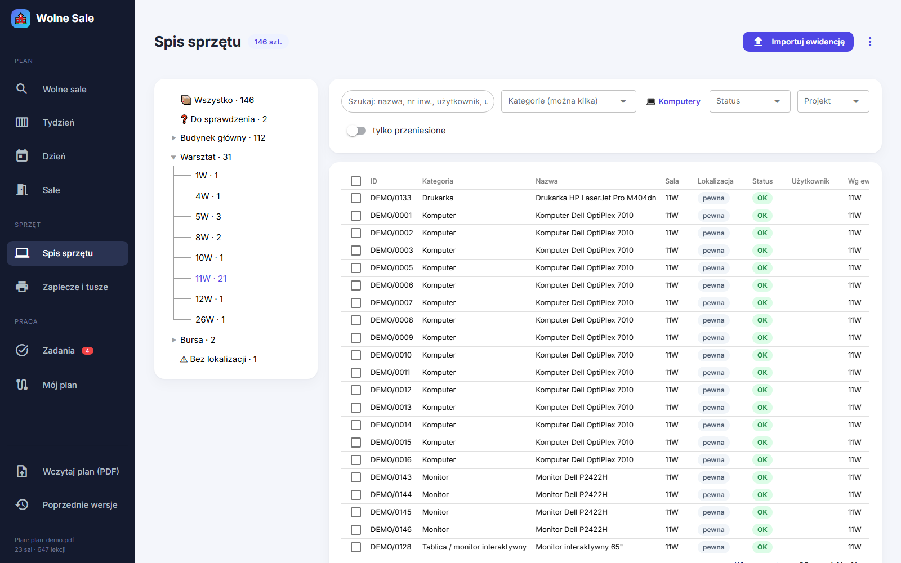
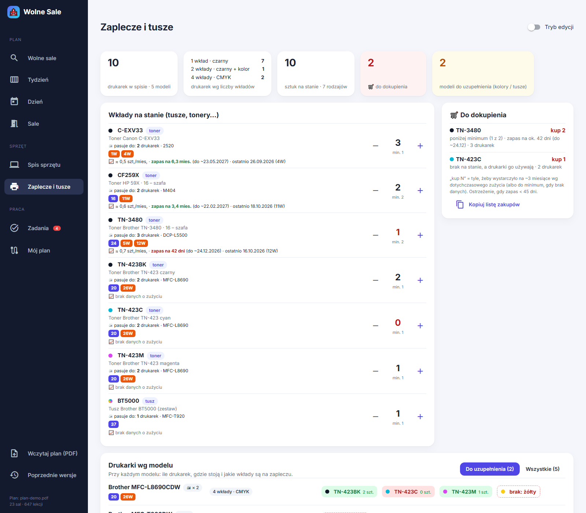

<div align="center">

# 🏫 School IT Hub

**A school IT technician's toolkit: find free classrooms from an aSc Timetables PDF, keep track of every
computer and device, manage printer cartridges and plan your work — in one desktop app.**

Windows · macOS · Python · works offline · your data stays on your computer

🇬🇧 English · [🇵🇱 Polski](README.pl.md)


</div>

> [!NOTE]
> The app's user interface is in **Polish**. All screenshots use **fictional demo data**
> (`Nauczyciel 01` = “Teacher 01”, devices `DEMO/…`). This is an independent tool, not affiliated with aSc Timetables.

---

## ✨ Features

| | |
|---|---|
| 🔎 **Free rooms** | When each room is free: one row per room, free lessons merged into windows (`1–2`, `5–6`). Filters: days, lesson range, “I need N lessons in a row”, building, **computer labs / rooms with a PC**, “What's free right now?”. Optional **working hours**: mark or hide windows that fall after your hours. |
| 🗓 **Week** / 📅 **Day** | All rooms at a glance. Hover a cell: lesson, time, subject, class, teacher. |
| 🚪 **Room** | Weekly timetable of one room, its free windows, equipment in the room and open tasks. |
| 🖥 **Equipment** | Import of the school's inventory spreadsheets (`.xls`). Free-text locations like `29/ w 12` or `15, 33, 2 w 16` are parsed into individual devices. Counts of PCs, laptops and Chromebooks per room (labs detected automatically), moving devices, statuses, full change history. |
| 🖨 **Printer supplies** | Cartridge stock, which cartridges each printer model needs (black / black + colour / CMYK), consumption from replacement dates, “stock lasts until…” forecast, shopping list. |
| ✅ **Tasks** | Tasks per room and bulk tasks (e.g. “update every lab computer”) with a checkbox grid and progress per room. |
| 🗺 **My schedule** | Your weekly working hours; used by Free rooms, Day and Week. |

| Week | Room |
|---|---|
|  |  |
| **Equipment** | **Printer supplies** |
|  |  |
| **Tasks** | **My schedule** |
|  |  |

---

## 🚀 Installation (from scratch)

### 1. Install Python 3.12 or newer
Download it from <https://www.python.org/downloads/>.
On **Windows**, tick **“Add python.exe to PATH”** in the installer.

### 2. Download this project
Either **Code → Download ZIP** on GitHub and unzip it, or:

```bash
git clone https://github.com/VoidSamuraj/school-it-hub.git
```

### 3. Run the installer
**Windows** — double-click **`instalacja-windows.bat`**.

**macOS / Linux** — open Terminal in the project folder and run:

```bash
python3 instaluj.py
```

The installer (`instaluj.py`) does everything and can be run again at any time — it never deletes anything:

1. checks the Python version,
2. creates the virtual environment `aplikacja/.venv`,
3. installs the libraries from `aplikacja/requirements.txt`,
4. creates the data folder `dane/` with its subfolders,
5. makes the start scripts executable (macOS / Linux).

### 4. Start the app
**Windows** — double-click **`start.bat`**
(if the app window does not open, use **`start-przegladarka.bat`** — the same app in your browser).

**macOS** — double-click **`start-mac.command`** (the first time: right-click → **Open**), or in Terminal:

```bash
./start-mac.command
```

### Folder structure after installation

```
school-it-hub/
├── instaluj.py               ← installer (all systems)
├── instalacja-windows.bat    ← installer, Windows (double-click)
├── instalacja-mac.command    ← installer, macOS (double-click)
├── start.bat                 ← start the app, Windows
├── start-przegladarka.bat    ← start in the browser, Windows
├── start-mac.command         ← start the app, macOS
├── aplikacja/                ← program code
│   ├── .venv/                ← created by the installer
│   ├── wolnesale/
│   └── requirements.txt
├── dane/                     ← created by the installer — YOUR data, never in git
│   ├── zrodla/               ← copies of imported PDFs and spreadsheets
│   ├── program/              ← plan.json, zasoby.xlsx (equipment, supplies, tasks…)
│   ├── kopie/                ← automatic backups
│   └── CZYTAJ.txt
└── dokumentacja/zrzuty/      ← screenshots
```

You don't have to put your files anywhere special — you pick them in the app and it keeps its own copy in `dane/zrodla/`.

---

## 🧭 First steps

1. **Wczytaj plan (PDF)** (*Load timetable*) — in aSc Timetables print the **teachers' timetables** to PDF and select the file.
   You get a report and confirm before anything is replaced.
   (aSc's XML export requires a licence; printing to PDF does not.)
2. **Spis sprzętu → Importuj ewidencję** (*Equipment → Import inventory*) — select the inventory `.xls` files
   (all at once is fine).
3. **Mój plan** (*My schedule*) — enter your working hours.

**Just want to look around?** Start with fictional demo data:

```bash
python instaluj.py --demo
```

then start the app with `start.bat --demo` (Windows) or `./start-mac.command --demo` (macOS).

### Launch options

| Option | What it does |
|---|---|
| *(none)* | desktop app window |
| `--browser` | in your web browser — <http://127.0.0.1:8765> |
| `--siec` | also reachable from a **phone** on the same Wi-Fi — `http://<computer-ip>:8765` |
| `--demo` | fictional demo data (folder `demo-dane/`) |
| `--dane FOLDER` | use data from another folder |

---

## 🔒 Data & privacy

- Everything runs **locally** — nothing is sent anywhere.
- All your data is in `dane/`, which is listed in `.gitignore` and **never goes into the repository**.
- `dane/program/zasoby.xlsx` can be opened in Excel / Numbers (just not while editing in the app at the same time).
- You can copy `dane/` to another computer (Windows ↔ Mac). Don't copy `aplikacja/.venv` — run the installer there instead.

## 🔄 Updating

```bash
git pull
```

then run the installer again (`instalacja-windows.bat` or `python3 instaluj.py`). Your `dane/` folder is not touched.

## 🛠 Troubleshooting

| Problem | Fix |
|---|---|
| “Python not found” | Install Python 3.12+; on Windows tick “Add python.exe to PATH”, then run the installer again. |
| The app window does not open (Windows) | Use `start-przegladarka.bat`. The window needs Microsoft Edge WebView2 (included in Windows 10/11). |
| macOS: “permission denied” / can't open the script | Run `python3 instaluj.py` once (it sets the permissions), then right-click `start-mac.command` → Open. |
| “Can't save zasoby.xlsx” | Close the file in Excel, then repeat the action. |

---

## 🧱 For developers

```
aplikacja/wolnesale/core/   logic without UI: aSc PDF parser, inventory import, free windows,
                            printer supplies & forecast, tasks, working hours
aplikacja/wolnesale/web/    user interface (NiceGUI)
aplikacja/tests/            pytest
```

Python · [NiceGUI](https://nicegui.io) · pdfplumber · openpyxl · xlrd · pywebview

Run the tests in the `aplikacja` folder:

```bash
.venv/bin/python -m pytest -q
```

(Windows: `.venv\Scripts\python -m pytest -q`.) Tests that need a real timetable PDF or inventory files are skipped when those files are absent.

**Assumptions about the input data**

- **Timetable:** PDF of *teachers' timetables* printed from aSc (one table per teacher, days × lessons, room in each cell).
- **Room names:** the suffix tells the building — `W` workshop, `B` dormitory, none = main building, `D1/D2/M1/M2` gyms.
  Adjust `aplikacja/wolnesale/core/sale.py` for your school.
- **Inventory:** spreadsheets with columns like *Nr inwentarza, Nazwa środka, Ilość, Pomieszczenie*
  (inventory number, item name, quantity, room) — as exported by Polish school accounting software.
