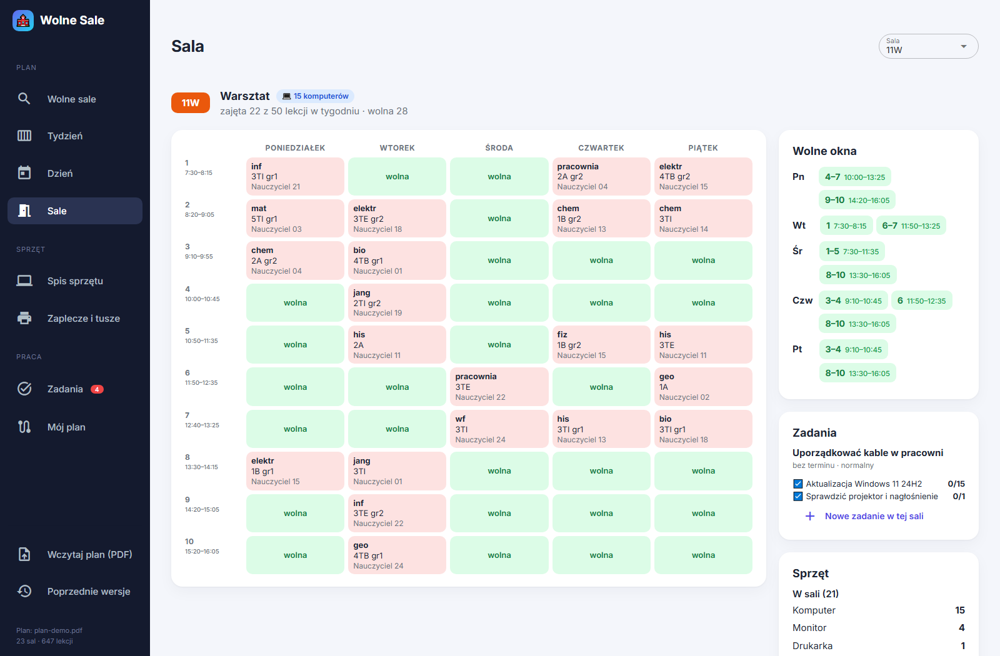

<div align="center">

# 🏫 Wolne Sale

**Plan lekcji z aSc → wolne sale, sprzęt w salach, tusze i zadania — w jednym programie dla szkolnego informatyka.**

Windows · macOS · Python · działa offline · dane zostają na Twoim komputerze


</div>

> ℹ️ Wszystkie zrzuty ekranu pokazują **fikcyjne dane demonstracyjne** (`Nauczyciel 01…`, sprzęt `DEMO/…`).
> Program jest niezależnym narzędziem i nie jest powiązany z twórcami aSc Plan Lekcji.

---

## ✨ Co potrafi

### 🔎 Wolne sale
Kiedy która sala jest wolna — **jeden wiersz na salę**, w każdym dniu połączone wolne okna (np. `1–2` i `5–6`).
Filtry: dni, zakres lekcji, „potrzebuję sali na N lekcji”, budynek, **sale IT / z komputerem**.
Przycisk **„Co jest wolne teraz?”**. Z **godzinami pracy** widać, co jest wolne, ale już po Twoich godzinach (🌙),
albo pokazuje tylko to, co się w nich mieści.

### 🗓 Tydzień i 📅 Dzień
| Tydzień — wszystkie sale na raz | Dzień — kto i co w każdej sali |
|---|---|
|  |  |

Dymek po najechaniu: lekcja, godziny, przedmiot, klasa, nauczyciel. Lekcje poza godzinami pracy są zakreskowane.

### 🚪 Sala
Plan tygodnia sali, wolne okna, **sprzęt w sali** (ile komputerów, laptopów, projektor…) i **zadania** dla tej sali.



### 🖥 Spis sprzętu
Import zestawień z **ewidencji księgowej (.xls)** — program sam rozczytuje opisy typu `29/ w 12`,
`12W użytkuje …`, `15, 33, 2 w 16` (kilka sztuk pod jednym numerem) i rozbija je na pojedyncze urządzenia.
Drzewko budynków i sal, filtry (kilka kategorii naraz), **przenoszenie**, statusy (serwis, wypożyczony),
pewność lokalizacji, **historia każdej zmiany**. Ponowny import od księgowej nie nadpisuje Twoich poprawek.


### 🖨 Zaplecze i tusze
Stany tonerów i tuszy, **ile wkładów ma każdy model drukarki** (czarny / czarny + kolor / CMYK) i których brakuje,
**średnie zużycie z dat wymian** i prognoza „na ile wystarczy zapas”, lista **do dokupienia** (do skopiowania).


### ✅ Zadania
Zadania w salach (termin, priorytet, status) oraz **zadania globalne** — np. „aktualizacja Windows na każdym
komputerze w salach IT” — z **tabelą checkboxów** i postępem na salę.


### 🗺 Mój plan
Tygodniowy grafik godzin pracy (od–do wg zegara). Wpływa na Wolne sale, Dzień i Tydzień.


---

## 🚀 Wypróbuj na danych demo (1 minuta)

Po instalacji (niżej) uruchom w folderze `aplikacja`:

```bash
python -m wolnesale --demo
```
(Windows z `.venv`: `.venv\Scripts\python -m wolnesale --demo`, macOS: `./start-mac.command --demo`)

Program utworzy folder `demo-dane/` z fikcyjnym planem, sprzętem, tuszami i zadaniami.

---

## ⚙️ Instalacja

Potrzebny jest **Python 3.12+** — https://www.python.org/downloads/ . Instalację robi się **raz** na komputerze.

### 🪟 Windows
1. Zainstaluj Pythona (zaznacz **„Add python.exe to PATH”**).
2. Dwuklik **`instalacja-windows.bat`** → poczekaj na „Gotowe”.
3. Uruchamiaj dwuklikiem **`start.bat`** (albo `start-przegladarka.bat` — to samo w przeglądarce).

### 🍎 macOS
1. Zainstaluj Pythona z python.org (albo `brew install python`).
2. W Terminalu, w folderze projektu:
   ```bash
   chmod +x instalacja-mac.command start-mac.command
   ```
   ```bash
   ./instalacja-mac.command
   ```
3. Uruchamiaj dwuklikiem **`start-mac.command`** (za pierwszym razem: prawy przycisk → **Otwórz**).

<details><summary>Instalacja ręczna</summary>

W folderze `aplikacja`:
```bash
python -m venv .venv
```
Windows:
```bash
.venv\Scripts\python -m pip install -r requirements.txt
```
macOS / Linux:
```bash
.venv/bin/python -m pip install -r requirements.txt
```
</details>

### Pierwsze kroki
1. **Wczytaj plan (PDF)** — w aSc wydrukuj **plany nauczycieli** do PDF (eksport XML wymaga licencji, PDF nie).
2. **Spis sprzętu → Importuj ewidencję** — zestawienia `.xls` od księgowej (można zaznaczyć wszystkie).
3. **Mój plan** — wpisz godziny pracy.

### Tryby uruchomienia
| Opcja | Co robi |
|---|---|
| *(brak)* | okno programu |
| `--browser` | w przeglądarce (http://127.0.0.1:8765) |
| `--siec` | dostęp z **telefonu** w tej samej sieci Wi-Fi: `http://<adres-komputera>:8765` |
| `--demo` | fikcyjne dane demonstracyjne |
| `--dane FOLDER` | dane z innego folderu |

---

## 🔒 Dane i prywatność

Program działa **lokalnie** — nic nie jest wysyłane do internetu. Wszystko leży w folderze `dane/`
(jest w `.gitignore`, więc **nie trafia do repozytorium**):

| Folder | Zawartość |
|---|---|
| `dane/zrodla/` | kopie wczytanych plików (PDF planu, xls z ewidencji) — program ich nie zmienia |
| `dane/program/plan.json` | aktywny plan lekcji |
| `dane/program/zasoby.xlsx` | sprzęt, historia, sale, zaplecze, zadania, godziny pracy — **można otwierać w Excelu** |
| `dane/kopie/` | automatyczne kopie zapasowe przed każdym zapisem |

Folder `dane/` możesz przenosić między komputerami (także Windows ↔ Mac). Folderu `aplikacja/.venv` nie przenoś.

---

## 🧱 Budowa

```
start.bat / start-mac.command      uruchamianie
instalacja-windows.bat / -mac      instalacja
aplikacja/
  wolnesale/core/                  logika (bez interfejsu): parser PDF aSc, import ewidencji, wolne okna,
                                   zaplecze i prognoza zużycia, zadania, godziny pracy
  wolnesale/web/                   interfejs (NiceGUI)
  tests/                           testy (pytest)
dokumentacja/                      plan projektu, zrzuty ekranu, makiety
```

Python · [NiceGUI](https://nicegui.io) · pdfplumber · openpyxl · xlrd · pywebview

**Testy** (w folderze `aplikacja`):
```bash
python -m pytest -q
```
Część testów korzysta z prawdziwego PDF-u i zestawień — uruchamiają się tylko, gdy są w `dane/`.
