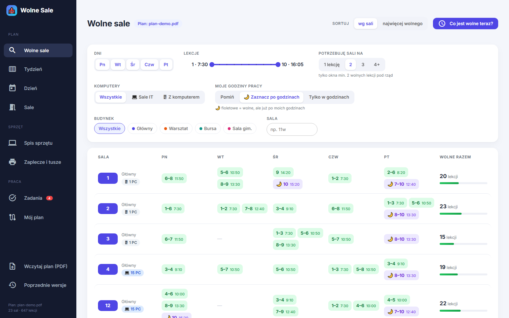
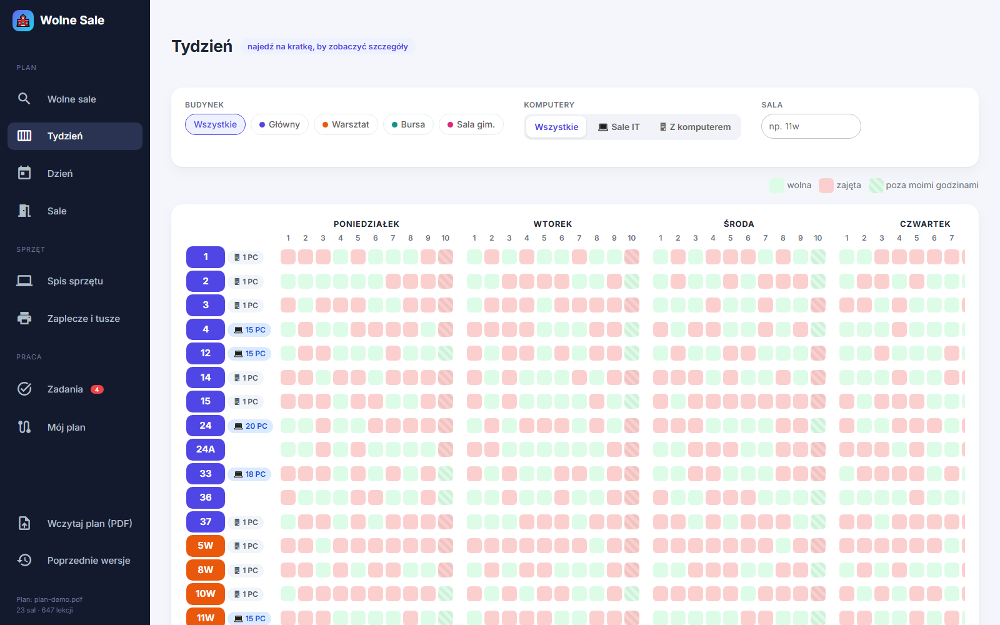
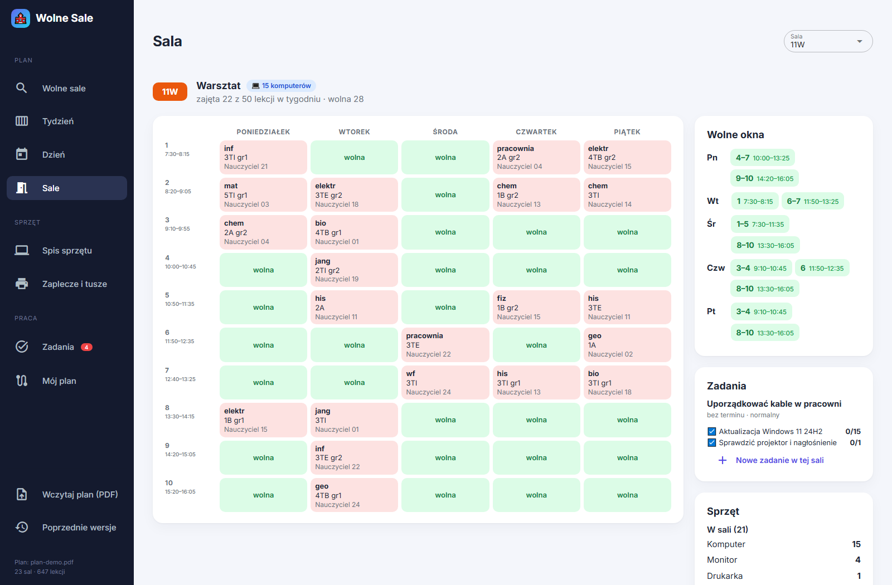
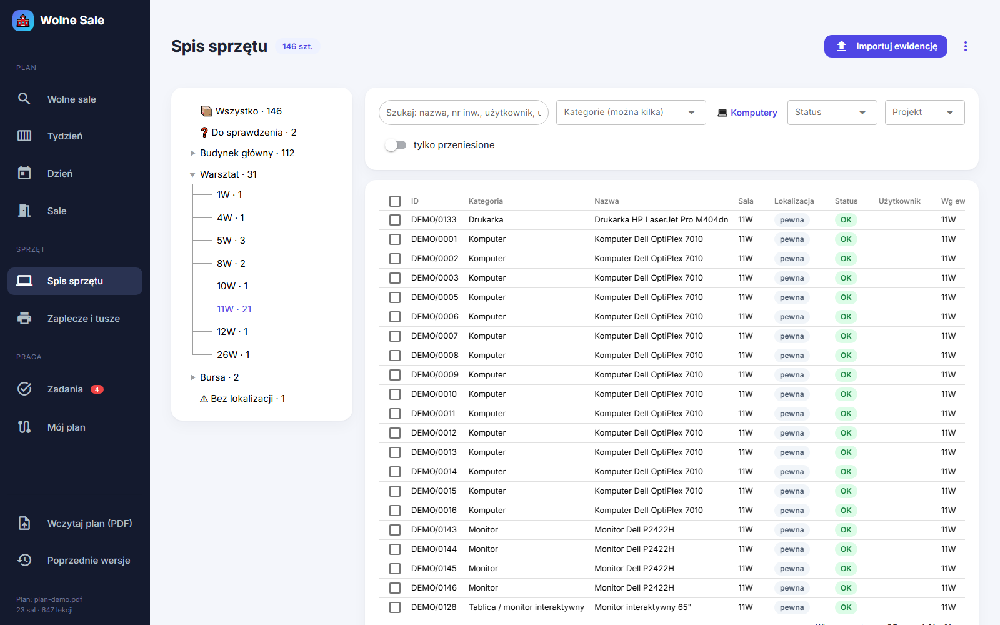
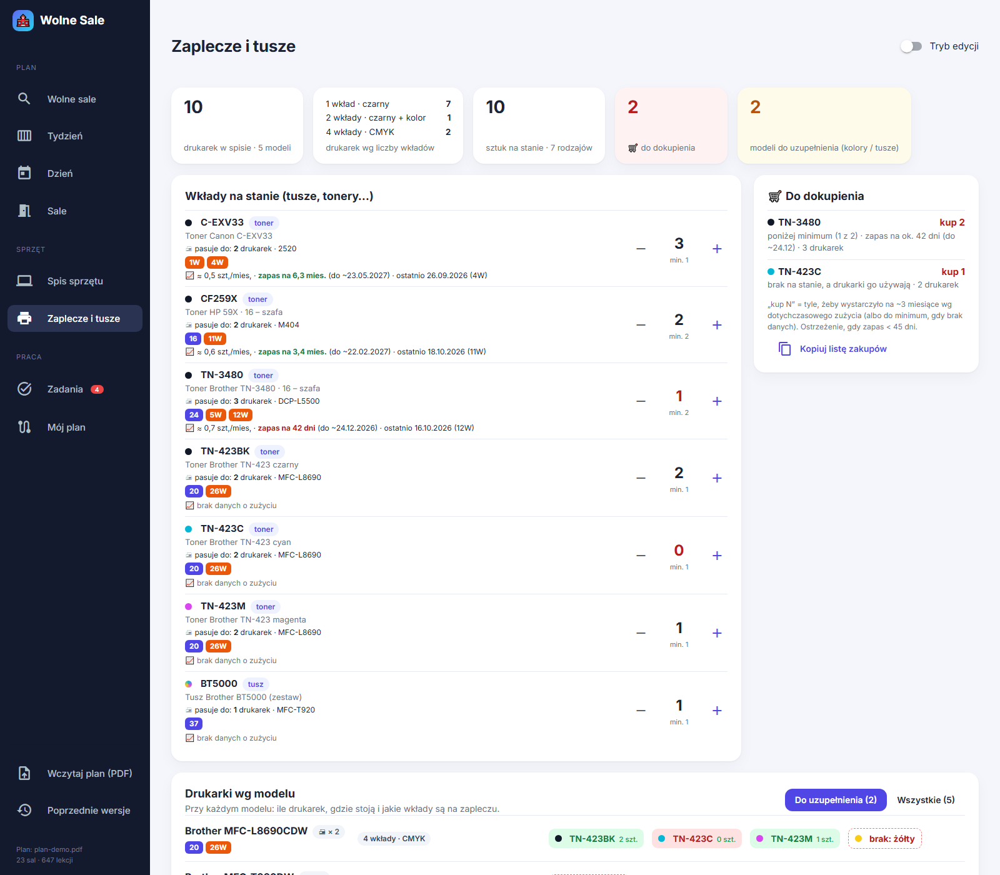
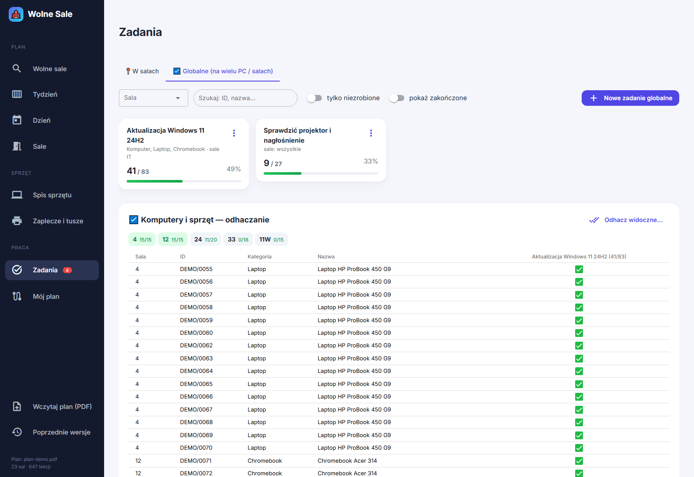
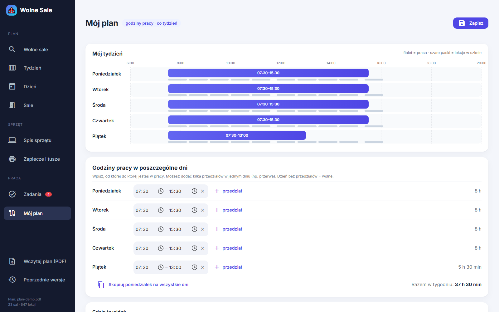

<div align="center">

# 🏫 School IT Hub

**Program dla szkolnego informatyka: wolne sale z planu aSc (PDF), spis komputerów i całego sprzętu,
tusze i tonery do drukarek oraz zadania — w jednym programie.**

Windows · macOS · Python · działa offline · dane zostają na Twoim komputerze

[🇬🇧 English](README.md) · 🇵🇱 Polski



</div>

> [!NOTE]
> Wszystkie zrzuty ekranu pokazują **fikcyjne dane demonstracyjne** (`Nauczyciel 01…`, sprzęt `DEMO/…`).
> Program jest niezależnym narzędziem i nie jest powiązany z twórcami aSc Plan Lekcji.

---

## ✨ Co potrafi

| | |
|---|---|
| 🔎 **Wolne sale** | Kiedy która sala jest wolna: jeden wiersz na salę, wolne lekcje połączone w okna (`1–2`, `5–6`). Filtry: dni, zakres lekcji, „potrzebuję sali na N lekcji”, budynek, **sale IT / z komputerem**, „Co jest wolne teraz?”. Opcjonalnie **godziny pracy**: zaznacz albo ukryj okna po Twoich godzinach. |
| 🗓 **Tydzień** / 📅 **Dzień** | Wszystkie sale naraz. Po najechaniu: lekcja, godziny, przedmiot, klasa, nauczyciel. |
| 🚪 **Sala** | Plan tygodnia sali, wolne okna, sprzęt w sali i otwarte zadania. |
| 🖥 **Spis sprzętu** | Import zestawień z ewidencji księgowej (`.xls`). Opisy typu `29/ w 12` czy `15, 33, 2 w 16` program rozbija na pojedyncze urządzenia. Liczba PC, laptopów i chromebooków w sali (pracownie wykrywane same), przenoszenie, statusy, pełna historia zmian. |
| 🖨 **Zaplecze i tusze** | Stany wkładów, ile wkładów ma każdy model drukarki (czarny / czarny + kolor / CMYK), zużycie z dat wymian, prognoza „zapas do…”, lista zakupów. |
| ✅ **Zadania** | Zadania w salach i zadania globalne (np. „aktualizacja na każdym PC w pracowniach”) z tabelą checkboxów i postępem na salę. |
| 🗺 **Mój plan** | Tygodniowe godziny pracy; korzystają z nich Wolne sale, Dzień i Tydzień. |

| Tydzień | Sala |
|---|---|
|  |  |
| **Spis sprzętu** | **Zaplecze i tusze** |
|  |  |
| **Zadania** | **Mój plan** |
|  |  |

---

## 🚀 Instalacja od zera

### 1. Zainstaluj Pythona 3.12 lub nowszego
Pobierz z <https://www.python.org/downloads/>.
Na **Windowsie** w instalatorze zaznacz **„Add python.exe to PATH”**.

### 2. Pobierz projekt
Na GitHubie **Code → Download ZIP** i rozpakuj, albo:

```bash
git clone https://github.com/VoidSamuraj/school-it-hub.git
```

### 3. Uruchom instalator
**Windows** — dwuklik **`instalacja-windows.bat`**.

**macOS / Linux** — otwórz Terminal w folderze projektu i wpisz:

```bash
python3 instaluj.py
```

Instalator (`instaluj.py`) robi wszystko sam i można go uruchamiać wielokrotnie — niczego nie kasuje:

1. sprawdza wersję Pythona,
2. tworzy środowisko `aplikacja/.venv`,
3. instaluje biblioteki z `aplikacja/requirements.txt`,
4. zakłada folder na dane `dane/` z podfolderami,
5. nadaje skryptom startowym prawo uruchamiania (macOS / Linux).

### 4. Uruchom program
**Windows** — dwuklik **`start.bat`**
(gdyby okno się nie otwierało: **`start-przegladarka.bat`** — to samo w przeglądarce).

**macOS** — dwuklik **`start-mac.command`** (za pierwszym razem: prawy przycisk → **Otwórz**) albo w Terminalu:

```bash
./start-mac.command
```

### Struktura folderów po instalacji

```
school-it-hub/
├── instaluj.py               ← instalator (każdy system)
├── instalacja-windows.bat    ← instalator, Windows (dwuklik)
├── instalacja-mac.command    ← instalator, macOS (dwuklik)
├── start.bat                 ← uruchomienie, Windows
├── start-przegladarka.bat    ← uruchomienie w przeglądarce, Windows
├── start-mac.command         ← uruchomienie, macOS
├── aplikacja/                ← kod programu
│   ├── .venv/                ← tworzy instalator
│   ├── wolnesale/
│   └── requirements.txt
├── dane/                     ← tworzy instalator — TWOJE dane, nigdy w gicie
│   ├── zrodla/               ← kopie wczytanych PDF-ów i zestawień
│   ├── program/              ← plan.json, zasoby.xlsx (sprzęt, tusze, zadania…)
│   ├── kopie/                ← automatyczne kopie zapasowe
│   └── CZYTAJ.txt
└── dokumentacja/zrzuty/      ← zrzuty ekranu
```

Swoich plików nie musisz nigdzie specjalnie wrzucać — wskazujesz je w programie, a on sam robi kopię w `dane/zrodla/`.

---

## 🧭 Pierwsze kroki

1. **Wczytaj plan (PDF)** — w aSc wydrukuj **plany nauczycieli** do PDF i wskaż plik.
   Przed podmianą planu dostajesz raport do zatwierdzenia.
   (Eksport XML z aSc wymaga licencji, wydruk do PDF — nie.)
2. **Spis sprzętu → Importuj ewidencję** — zaznacz zestawienia `.xls` od księgowej (można wszystkie naraz).
3. **Mój plan** — wpisz godziny pracy.

**Chcesz najpierw tylko obejrzeć?** Dane demo (fikcyjne):

```bash
python instaluj.py --demo
```

potem uruchom `start.bat --demo` (Windows) albo `./start-mac.command --demo` (macOS).

### Opcje uruchomienia

| Opcja | Co robi |
|---|---|
| *(brak)* | okno programu |
| `--browser` | w przeglądarce — <http://127.0.0.1:8765> |
| `--siec` | dostęp także z **telefonu** w tej samej sieci Wi-Fi — `http://<adres-komputera>:8765` |
| `--demo` | fikcyjne dane demonstracyjne (folder `demo-dane/`) |
| `--dane FOLDER` | dane z innego folderu |

---

## 🔒 Dane i prywatność

- Program działa **lokalnie** — nic nie jest nigdzie wysyłane.
- Wszystkie Twoje dane są w `dane/`, który jest w `.gitignore` i **nigdy nie trafia do repozytorium**.
- `dane/program/zasoby.xlsx` można otwierać w Excelu / Numbers (tylko nie edytuj go jednocześnie w programie).
- Folder `dane/` możesz skopiować na inny komputer (Windows ↔ Mac). `aplikacja/.venv` nie kopiuj — uruchom tam instalator.

## 🔄 Aktualizacja

```bash
git pull
```

potem uruchom instalator jeszcze raz (`instalacja-windows.bat` albo `python3 instaluj.py`). Folder `dane/` zostaje nietknięty.

## 🛠 Problemy

| Problem | Rozwiązanie |
|---|---|
| „Nie znaleziono Pythona” | Zainstaluj Pythona 3.12+; na Windows zaznacz „Add python.exe to PATH” i uruchom instalator ponownie. |
| Okno programu się nie otwiera (Windows) | Użyj `start-przegladarka.bat`. Okno wymaga Microsoft Edge WebView2 (jest w Windows 10/11). |
| macOS: „permission denied” / nie da się otworzyć skryptu | Uruchom raz `python3 instaluj.py` (ustawia uprawnienia), potem prawy przycisk na `start-mac.command` → Otwórz. |
| „Nie mogę zapisać zasoby.xlsx” | Zamknij plik w Excelu i powtórz czynność. |

---

## 🧱 Dla programistów

```
aplikacja/wolnesale/core/   logika bez interfejsu: parser PDF z aSc, import ewidencji, wolne okna,
                            zaplecze i prognoza zużycia, zadania, godziny pracy
aplikacja/wolnesale/web/    interfejs (NiceGUI)
aplikacja/tests/            testy (pytest)
```

Python · [NiceGUI](https://nicegui.io) · pdfplumber · openpyxl · xlrd · pywebview

Testy w folderze `aplikacja`:

```bash
.venv/bin/python -m pytest -q
```

(Windows: `.venv\Scripts\python -m pytest -q`.) Testy wymagające prawdziwego PDF-u lub zestawień są pomijane, gdy tych plików nie ma.

**Założenia co do danych wejściowych**

- **Plan:** PDF z *planami nauczycieli* wydrukowany z aSc (jedna tabela na nauczyciela, dni × lekcje, sala w komórce).
- **Nazwy sal:** końcówka oznacza budynek — `W` warsztat, `B` bursa, bez końcówki = budynek główny, `D1/D2/M1/M2` sale gimnastyczne.
  Dla innej szkoły dostosuj `aplikacja/wolnesale/core/sale.py`.
- **Ewidencja:** arkusze z kolumnami typu *Nr inwentarza, Nazwa środka, Ilość, Pomieszczenie* — format z programów księgowych szkół.
